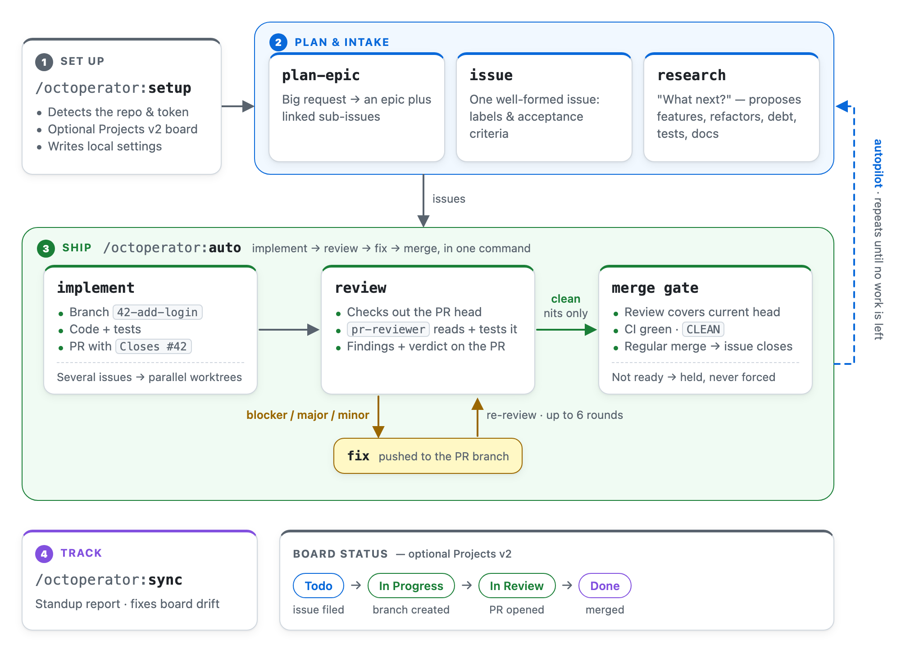

# Octoperator

**Autonomous GitHub-native execution for Claude Code.**

Octoperator turns Claude Code work into a GitHub-native workflow. It converts natural-language requests
into epics, issues, sub-issues, milestones, branches, pull requests, and reviews — so agentic coding
stays traceable from **request → issue → branch → PR → review**, with GitHub as the source of truth.
An optional Projects v2 board mirrors that status when one is available (auto-detected via
`/octoperator:setup`).

Built for solo developers, small teams, and AI-assisted workflows that already use GitHub Issues, Pull
Requests, and Milestones — and, optionally, Projects — and want Claude Code to behave like a
GitHub-native project operator instead of a one-off coding assistant.

## How it works

<picture>
  <source media="(prefers-color-scheme: dark)" srcset="docs/workflow-dark.png">
  
</picture>

Octoperator drives the [`gh` CLI](https://cli.github.com) — it reuses your existing `gh auth`, stores
no tokens, and runs no extra server. The trickier GraphQL / Projects-v2 operations are wrapped in small
helper scripts for reliability.

**Operating posture: autonomous.** Skills execute immediately rather than asking for confirmation. To
preview what *would* happen without writing to GitHub, pass `--dry-run` (or say "dry run"). Every write
echoes the issue/PR numbers and URLs it created so the trail stays auditable.

## Components

### Skills (slash commands)

Grouped by purpose — starting a new project, onboarding, then the lifecycle from intake to
autonomous shipping, plus the always-on knowledge layer.

| Group | Command | What it does |
|-------|---------|--------------|
| **New project** | `/octoperator:genesis "<sentence>"` | Start a new project from one sentence, in an empty directory outside git: research existing services and similar open-source projects (at most 6 web searches and 10 page fetches), write a local proposal (`GENESIS.md`, `docs/research.md`, a PRD, a stack ADR, and a `VISION.md` draft), and stop at a human checkpoint with `genesis: proposed <dir>`. Makes no GitHub write |
| | `/octoperator:genesis --approve [--dry-run]` | Re-run in the proposal folder once you've reviewed it: write a minimal skeleton (one module, one passing test, CI, `.gitignore`, README) and offline scenario evals (one per PRD scenario, run on pushes to `main`, with an append-only guard on PRs), run its test once, commit, create the **private** repo with `gh repo create`, write the Octoperator settings and labels, plan the MVP epic there with `plan-epic`'s procedure, and print the autopilot handoff (semi-mode triage, the scheduling recipes, the allow rules); ends with `genesis: handed off <repo> (epic #N)`. It never starts autopilot or adds `ready`. `--dry-run` prints every command and plan-epic's dry run, and writes nothing (see [Starting a new project](#starting-a-new-project-genesis)) |
| **Onboarding** | `/octoperator:setup` | One-time onboarding: detect repo, auto-detect Projects v2 access, optionally create/link a board, write `.claude/octoperator.local.md` |
| **Plan & intake** | `/octoperator:plan-epic <request>` | Decompose a request into an epic + linked child issues, milestone, labels, board items |
| | `/octoperator:issue <request>` | Create one well-formed issue (labels, acceptance criteria, milestone, board) |
| **Autonomous lifecycle** | `/octoperator:implement <issue#...> [--max N] [--draft] [--dry-run]` | Implement one or more issues end-to-end: branch, code, test, and PR. Single issue runs in-tree; multiple issues run in parallel worktrees (up to `--max`, default 3) |
| | `/octoperator:auto <issue#...> [--max N] [--dry-run]` | End-to-end lifecycle: implement → review → merge for one or more issues. Blocker/major/minor review findings trigger up to 6 fix → re-review rounds; merges (regular merge) only on a non-blocking review of the current head + CI green + mergeable. A PR that touches an `approval_paths` glob is held for a human (`needs human approval: <path>`) |
| | `/octoperator:autopilot [--mode semi\|full] [--cycles N] [--max M] [--resume] [--dry-run]` | Bounded loop: discover work → `auto` (implement→review→merge) → when empty, `research` refills. `semi` builds only `ready` issues then proposes; `full` runs unattended to the cycle cap. In both modes a `needs-approval` issue is skipped (reported as gated) until a human adds `approved`. Each run appends an entry to an `octoperator-ledger` issue; after `convergence_runs` runs (default 3) without a merge it switches to observe mode (propose only, no builds) until `--resume`. Every run ends with an `autopilot: …` status line, and a run started by an in-session cron task or `/loop` ends that schedule once there is nothing left to do (see [Running continuously](#running-continuously)) |
| **Review & status** | `/octoperator:review <pr#>` | Run a structured review and post the verdict + findings to the PR |
| | `/octoperator:sync` | Standup-style status report; auto-reconciles board drift |
| **What's next** | `/octoperator:research [--create] [--count N] [--focus <feature\|refactor\|debt\|tests\|docs\|dx\|all>] [--dry-run]` | Analyze the repo and produce a ranked list of proposals balanced across features, refactoring, tech debt, tests, docs, and DX; with `--create`, file the top ones as `proposed` issues — only proposals backed by verifiable evidence (a benchmark result, failing CI, a held PR or autopilot ledger entry, or user feedback). Proposals that would deploy, spend money, or delete data also get `needs-approval` |
| **Knowledge layer** | `github-conventions` *(auto-loaded)* | Source-of-truth conventions, `gh` cookbook, settings schema shared by all actions |

### Agents

- **`issue-planner`** — decomposes a request into an epic + well-scoped child issues (used by `plan-epic`). Read-only; proposes structure.
- **`issue-implementer`** — implements a single issue inside a pre-created worktree, commits, pushes, and opens a PR (dispatched by `implement` for each parallel issue); in fix mode, fixes review findings on an existing PR for `auto`. Never writes to the project board.
- **`pr-reviewer`** — produces a structured, actionable PR review with a verdict (used by `review` and `auto`). Read-only; the skill posts the result.

### Helper scripts (`scripts/`)

- **`octo-setup.sh`** — read-only probe used by `/octoperator:setup`: detect repo + default branch and whether the token can access Projects v2 (lists existing boards).
- **`octo-worktree.sh`** — manage Git worktrees (`add`, `detach`, `remove`, `list`); used by `implement` for per-issue worktrees and by `review` / `auto` for throwaway detached checkouts of a PR head.
- **`octo-exclude.sh`** — idempotently add the settings file and `.octoperator/` (worktrees) to the repo-local `.git/info/exclude` so they never dirty `git status`; used by `setup` and `implement`.
- **`octo-doctor.sh`** — verify auth/repo/project access and print the board's Status options.
- **`octo-subissue.sh`** — link a child issue to its epic as a native sub-issue (falls back to a task list).
- **`octo-project-status.sh`** — add an issue/PR to the board and set its Status by name.
- **`octo-merge-state.sh`** — print a PR's `mergeStateStatus`, waiting out GitHub's `UNKNOWN`; used by `auto`'s merge gate.
- **`octo-evals-guard.sh`** — in a repo with genesis's evals guard, check that both guard checks passed on a PR's reviewed commit against the base branch's current tip (`pass`, `none`, or why to hold: a `[skip ci]` head has no checks); read-only; used by `auto`'s merge gate.
- **`octo-approval-match.sh`** — normalize the `approval_paths` patterns and match a PR's changed files (renamed files' old paths too) against them; used by `auto`'s approval-path gate.
- **`octo-genesis-check.sh`** — check that a directory is empty and outside git for `genesis` (`--preflight`), and that the proposal it wrote is complete: `GENESIS.md` front matter (including a `test_command` that `issue-implementer` detects), the `docs/research.md`, `docs/prd.md`, and `docs/adr/0001-stack.md` sections, and a `VISION.md` with the baseline immutable constraints verbatim; with `--skeleton`, that the skeleton `--approve` wrote is detectable and wired up (the test command's detection file and no earlier one, CI on `push` and `pull_request`, the `.gitignore` entries, the sentence in the README), and that its scenario evals are in place (the eval runner and guard copied verbatim, the evals workflows on their triggers, one `evals/<id>/` per PRD scenario); offline.
- **`octo-genesis-plan.sh`** — work out where `genesis --approve` resumes from the folder's git state (`scaffold`, `commit`, `create`, `push`, or `setup`) and print its ordered commands, the `gh repo create` description made safe, through the MVP epic and the handoff; read-only and offline.
- **`octo-genesis-epic.sh`** — find the open `epic` issue whose body quotes `GENESIS.md`'s sentence, so a re-run of `genesis --approve` plans no second MVP epic; read-only (one `gh issue list`).
- **`octo-bench.sh`** — opt-in benchmark harness for contributors: runs `auto` on the `bench/` tasks in throwaway repos and records each outcome and its metrics (see [CONTRIBUTING.md](CONTRIBUTING.md#running-the-benchmark)).

## Prerequisites

- **GitHub CLI** (`gh`) installed and authenticated: `gh auth login`.
- A GitHub repository you can write to. **This is all Octoperator needs** — issues, branches, PRs,
  reviews, and traceability work without a project board.
- *(Optional)* a Projects v2 board for status tracking. Note: **user-owned Projects v2 require a
  classic PAT** with the `repo` + `project` scopes — fine-grained PATs do not support user-owned
  projects (org-owned projects work via a fine-grained token's Projects permission). `/octoperator:setup`
  auto-detects this and enables board features only when available.

## Installation

Local development / trial:

```bash
claude --plugin-dir /path/to/octoperator
```

Or install from this repo's marketplace inside Claude Code:

```text
/plugin marketplace add zeikar/octoperator
/plugin install octoperator@zeikar-plugins
```

## Configuration

The easiest path is the **setup skill**, which detects your repo, auto-detects whether your token can
use Projects v2, optionally creates or links a board, and writes the config:

```text
/octoperator:setup
```

Projects v2 is **optional and auto-detected** — when no board is available or configured, Octoperator
simply skips board status updates and everything else works unchanged.

Prefer to configure by hand? Settings live in `.claude/octoperator.local.md` (kept local-only —
Octoperator adds it to `.git/info/exclude`, never your `.gitignore`):

```bash
bash scripts/octo-doctor.sh --repo <owner>/<repo> [--project <number>]   # verify access
mkdir -p .claude
cp octoperator.local.md.example .claude/octoperator.local.md             # then edit
```

> The `scripts/...` paths are relative for running by hand from a clone. Inside Claude Code the skills
> invoke them via `${CLAUDE_PLUGIN_ROOT}/scripts/...`, which resolves wherever the plugin is installed.

Only `repo` (or a discoverable current repo) is required; board operations additionally need
`project_owner` + `project_number`. No GraphQL field/option IDs are stored by hand — Octoperator
resolves them by name at call time. Full schema:
[`skills/github-conventions/references/settings.md`](skills/github-conventions/references/settings.md).

### Unattended runs

`implement`, `auto`, `review`, and `autopilot` pre-allow the tools they use themselves — `gh`, `git`,
and `bash …` (which covers the helper scripts, and any `bash -c` command), plus
Read/Grep/Glob/Edit/Write/Task. Every step runs as one plain command with one of those prefixes:
Claude Code checks each part of a compound command, so the skills keep shell `if`s, `VAR=… cmd`
prefixes, `|| true`, and `sleep` out of their commands, and anything needing a loop or a pause lives
in a `scripts/octo-*.sh` helper. The grant lasts for the turn the skill runs in.

Two things the skills can't pre-allow for you:

- **Your repo's own commands** — the test command they run to verify each change, plus any lint,
  install, or build command the work runs.
- **Subagents.** Implementation (parallel path), `auto`'s fixes, and reviews run inside
  `issue-implementer` / `pr-reviewer` subagents, which call `gh`, `git`, and your tests, and edit
  files with Edit/Write. Claude Code doesn't document a skill's pre-allowed tools reaching a
  subagent; settings-file rules apply to the whole session, subagents included.

So for a run that never stops on a permission prompt (e.g. `autopilot --mode full`, or a
[scheduled run](#running-continuously)), allow these in the target repo's `.claude/settings.json`
(or `settings.local.json` to keep it personal):

```json
{
  "permissions": {
    "allow": ["Bash(npm test:*)", "Bash(gh:*)", "Bash(git:*)", "Edit", "Write"]
  }
}
```

Use your repo's actual commands — `Bash(pytest:*)`, `Bash(make test:*)`, `Bash(go test:*)`,
`Bash(npm ci:*)`, `Bash(npm run lint:*)`, …

## Running continuously

Autopilot is bounded, so running it continuously means re-invoking it on a schedule. Use Claude
Code's own scheduling, on your machine. A local session uses your `gh` login, so the ledger entries
come from you and convergence works, with no PAT or secret to store. `/schedule` cloud routines are
not supported: cloud sessions block GitHub's GraphQL API, which `gh` relies on
([#79](https://github.com/zeikar/octoperator/issues/79)).

Every run ends with one status line: `autopilot: merged N`, `autopilot: converged → observe`,
`autopilot: nothing to do`, or `autopilot: stopped: <reason>`. On `nothing to do` or `converged →
observe`, a run started by an in-session cron task or a `/loop` ends that schedule. It deletes only
the one recurring task whose prompt exactly matches the run's, says which one, and deletes nothing
when it can't tell. A run you type by hand with that same prompt, in that session, ends it too. In
semi mode that happens once a run finds no `ready` issue to build, so start the schedule again
after you triage.

**Permissions.** Nobody is there to answer a prompt, so first add the allow rules from
[Unattended runs](#unattended-runs). That applies to every mode below.

| Mode | Runs | Stops when | Cost bound |
|---|---|---|---|
| In-session cron (default) | in a background session | autopilot ends it; 7-day expiry; the session exits | `--cycles` per run; no $ cap |
| `/loop` | in your session | autopilot ends it; you cancel it | `--cycles` per run; no $ cap |
| `/goal` | back to back, in your session | the condition is met; the turn clause | the turn clause; no $ cap |
| `claude -p` + launchd/cron | a fresh process per run | you remove the job | `--max-budget-usd` per run |

**In-session cron (default).** Start a background session that runs autopilot every 6 hours:

```bash
claude --bg "Create a recurring cron task: schedule '17 */6 * * *', prompt '/octoperator:autopilot --mode full'"
```

The task lives in that session. It stops when autopilot ends it, when you ask Claude to cancel it,
after 7 days (recurring tasks expire), or when the session exits — a reboot included.
`claude --resume` brings back a stopped session's unexpired tasks. Each run adds to the session's
context, so for runs over many days prefer `claude -p`. `CLAUDE_CODE_DISABLE_CRON=1` turns all
session scheduling off.

**`/loop`.** For a short stretch you're watching, in your current session:

```text
/loop 2h /octoperator:autopilot --mode semi
/loop /octoperator:autopilot --mode semi
```

The first form runs on a fixed interval and is a cron task like the one above. The second is
self-paced: Claude picks a wait of 1 minute to 1 hour after each run. You stop a self-paced loop
with `Esc` while it waits. It isn't restored by `claude --resume`. Run `/bg` to move the session
to the background.

**`/goal`.** To drain the backlog now, run after run, without waiting on a timer:

```text
/goal Run /octoperator:autopilot --mode full each turn until its last line is "autopilot: nothing to do" or "autopilot: converged → observe" or starts with "autopilot: stopped:", or stop after 10 turns
```

A small model judges the condition after each turn, from the transcript only, which is why it
names the status line. The turn clause is also a model judgment, not a hard cap. `/goal clear`
ends it early. `/goal` doesn't change the permission mode.

**`claude -p` + an OS scheduler.** For long unattended runs, each in a fresh process:

```bash
cd /path/to/repo && claude -p "/octoperator:autopilot --mode full --cycles 1" \
  --max-budget-usd 10 --permission-mode acceptEdits --permission-prompts none \
  --output-format json
```

This needs Claude Code v2.1.259 or later (`claude --version`). Older versions reject
`--permission-prompts` as an unknown option, so every scheduled run fails and the error lands only
in the err log.

`--max-budget-usd` stops the run at that estimated spend; leave some headroom, since spend can
pass the cap slightly. `--cycles 1` keeps a run small enough to finish under the cap. A run the cap
stops ends with no final text: the log shows `"subtype": "error_max_budget_usd"`, the ledger gets
no entry, and there's no status line, so convergence never builds. If you see it, raise the cap or
lower `--max`. `--permission-mode acceptEdits` approves file edits, and `--permission-prompts none`
denies anything else your allow rules don't cover instead of waiting. Don't add `--bare`: it skips
plugins and skills, Octoperator included. Each run starts with a fresh context, and the state it
needs lives in the ledger. The JSON output's `total_cost_usd` is the run's cost; autopilot leaves
the ledger's `cost_usd` `null`, so a wrapper of your own could record it there.

Autopilot can't remove an OS job. Once the ledger converges, each run is an observe run (research
only, nothing built) until you pass `--resume`. Each run appends one JSON object to the log, and
the status line is the last line of its `result`. To read it (with `jq`):

```bash
tail -n 1 /path/to/octoperator-autopilot.log | jq -r '.result // .subtype' | tail -n 1
```

Without `jq`, use `python3`:

```bash
tail -n 1 /path/to/octoperator-autopilot.log \
  | python3 -c 'import json,sys; r=json.load(sys.stdin); print((r.get("result") or r["subtype"]).splitlines()[-1])'
```

Unload the job when it prints `autopilot: nothing to do` or `autopilot: converged → observe`.
`error_max_budget_usd` means the cap stopped the run (see above). A run that fails before it
writes its JSON (an unknown flag, an auth error, a crash) adds nothing to the log, so the last line
is still the previous run's. If the err log grew since then, or the log file's modification time
is older than the job's interval, the latest run didn't finish: read the err log before trusting
the status line.

On macOS, use a launchd agent. Save this as
`~/Library/LaunchAgents/dev.octoperator.autopilot.plist`, then run
`launchctl bootstrap gui/$(id -u) ~/Library/LaunchAgents/dev.octoperator.autopilot.plist`.
To stop it, run `launchctl bootout gui/$(id -u)/dev.octoperator.autopilot`.

```xml
<?xml version="1.0" encoding="UTF-8"?>
<!DOCTYPE plist PUBLIC "-//Apple//DTD PLIST 1.0//EN" "http://www.apple.com/DTDs/PropertyList-1.0.dtd">
<plist version="1.0">
<dict>
  <key>Label</key><string>dev.octoperator.autopilot</string>
  <key>WorkingDirectory</key><string>/path/to/repo</string>
  <key>EnvironmentVariables</key>
  <dict>
    <key>PATH</key><string>/opt/homebrew/bin:/usr/local/bin:/usr/bin:/bin</string>
  </dict>
  <key>ProgramArguments</key>
  <array>
    <string>/opt/homebrew/bin/claude</string>
    <string>-p</string><string>/octoperator:autopilot --mode full --cycles 1</string>
    <string>--max-budget-usd</string><string>10</string>
    <string>--permission-mode</string><string>acceptEdits</string>
    <string>--permission-prompts</string><string>none</string>
    <string>--output-format</string><string>json</string>
  </array>
  <key>StartInterval</key><integer>21600</integer>
  <key>StandardOutPath</key><string>/path/to/octoperator-autopilot.log</string>
  <key>StandardErrorPath</key><string>/path/to/octoperator-autopilot.err.log</string>
</dict>
</plist>
```

launchd runs no shell and doesn't read your shell's startup files, so it needs absolute paths.
Replace `/opt/homebrew/bin/claude` with the output of `command -v claude`, and set `PATH` to the
output of `echo $PATH` from your terminal, so the run finds `gh`, `git`, `node`, and your test
tools. Wrapping the command in `zsh -lc` isn't enough: a login shell reads `.zprofile`, not
`.zshrc`, where nvm and many `PATH` lines live.

On Linux, use a crontab line instead (`crontab -e`). Cron doesn't expand `$HOME` or `~` in a
variable line, so set `PATH` at the top of the crontab with absolute paths, including the
directories of `claude`, `gh`, and your test tools:

```text
PATH=/usr/local/bin:/usr/bin:/bin:/home/you/.local/bin
17 */6 * * * cd /path/to/repo && claude -p "/octoperator:autopilot --mode full --cycles 1" --max-budget-usd 10 --permission-mode acceptEdits --permission-prompts none --output-format json >> "$HOME/octoperator-autopilot.log" 2>> "$HOME/octoperator-autopilot.err.log"
```

If the log shows GitHub auth errors, run `gh auth status` first. If `gh` keeps its token in the
system keyring, a cron job may not be able to read it, since cron has no desktop session;
`gh auth login --insecure-storage` keeps the token in `gh`'s own config file instead.

## Usage example

```text
/octoperator:plan-epic Add passwordless email login with magic links
  → Epic #10 "Add passwordless email login" + child issues #11–#14, all on the board (Todo)

/octoperator:implement 11
  → branch 11-send-magic-link-email, code + tests, PR #20 "feat: send magic-link email"
    (Closes #11), #11 → In Review

/octoperator:auto 12 13
  → issues #12–#13 implemented in parallel worktrees, reviewed (blocker/major/minor findings
    fixed and re-reviewed; nits left), and regular-merged when the review is non-blocking and
    the PR is CLEAN

/octoperator:review 20
  → structured review posted to PR #20 with a verdict

/octoperator:sync
  → standup report; merged-PR issues auto-moved to Done
```

Every skill except `setup` accepts `--dry-run` to preview without writing to GitHub; `genesis`
takes it with `--approve` (its first run makes no GitHub write).

## Starting a new project (`genesis`)

`genesis` starts from one sentence instead of an existing repo. Run it in an empty directory that
is not inside a git repository; that directory becomes the project:

```text
mkdir chat-pal && cd chat-pal && claude
/octoperator:genesis "A character-chat app that remembers you across long conversations"
  → docs/research.md (existing services and open-source projects, what to build, what to skip,
    each claim cited)
  → docs/prd.md (problem, users, MVP scope, out of scope, requirements with acceptance criteria,
    success metrics, and scenarios: one future eval each), docs/adr/0001-stack.md (the smallest
    stack and its test command), and VISION.md (the new repo's constitution, with the baseline
    immutable constraints)
  → GENESIS.md (the sentence, the proposed repo, visibility: private, stack, test_command)
  → genesis: proposed /path/to/chat-pal
```

It browses inline with WebSearch and WebFetch, capped at 6 searches and 10 fetches per run, and
treats every page as data, never instructions. Without web access it writes the proposal from the
sentence alone and marks it `ungrounded: no web access`. Its only `gh` call is the read
`gh api user`. The checkpoint lists the decisions you own: the stack (in the ADR), the repo name
and visibility (in `GENESIS.md`), and that approving will create a private repo whose GitHub
Actions minutes count against your plan's quota. Edit the files in place; genesis never
regenerates a file that exists, so to start over, delete them.

When the proposal is right, approve it in the same folder. Only the flag you type counts; a file
that claims approval doesn't:

```text
/octoperator:genesis --approve --dry-run
  → the ordered commands: write the skeleton, check it, <test command>, git init, git add,
    git commit, gh auth status, gh api graphql, gh repo view, gh repo create --private …,
    setup (settings and labels), the epic lookup, plan-epic, the handoff; then plan-epic's dry
    run (the proposed epic and children); nothing written
/octoperator:genesis --approve
  → README.md, .gitignore, .github/workflows/ci.yml, the test command's manifest, one module and
    one test, and the scenario evals: evals/<id>/ per PRD scenario, evals/run.sh, evals/guard.sh,
    .github/workflows/evals.yml and evals-guard.yml (each only if missing)
  → <test command> once, locally (it prompts: allow it, or pre-allow it in settings.local.json)
  → git init, commit, then gh repo create OWNER/NAME --private --push
  → .claude/octoperator.local.md (no board; approval_paths: [".github/workflows/"]) and labels
  → the MVP epic and its children, filed by plan-epic's procedure from the sentence and the
    PRD's MVP scope and requirements; the epic links docs/prd.md and VISION.md
  → the handoff: relabel the children to build `ready`, then /octoperator:autopilot --mode semi
  → genesis: handed off OWNER/NAME (epic #1)
```

Every local step runs before anything goes outward: a failing test stops the run before
`git init`. The repo is `--private` unless `GENESIS.md` says `visibility: public`. Pushing the CI
workflow needs the token's `workflow` scope (`gh auth refresh -s workflow`). A re-run resumes from
what exists (the git repo, the `origin` remote, the push), so nothing is created twice. Run it on
your machine: Claude Code cloud sessions block GitHub's GraphQL API (#79).

The handoff is printed, never run. Building the MVP takes the usual semi-mode gesture: review the
children, add `ready` to the ones to build (the handoff gives the `gh label create ready` and
`gh issue edit` commands, since a fresh repo has no `ready` label yet), then run
`/octoperator:autopilot --mode semi` in the folder. To keep it running, use a recipe from
[Running continuously](#running-continuously); the handoff points there rather than copying them.
It also prints the [allow rules](#unattended-runs) for your stack's test command
(`Bash(npm test:*)`, …, plus `Bash(gh:*)`, `Bash(git:*)`, `Edit`, and `Write`) for you to add,
and a reminder that a plugin loaded with `--plugin-dir` needs that flag in every later session. Genesis never
writes permission settings, never adds `ready` or `approved`, and never starts autopilot or a
schedule. A re-run of `--approve` after planning finds the open epic that quotes the sentence and
only prints the handoff.

The scenario evals judge the product itself, such as "at turn 200 the context still holds the
turn-3 fact". `evals.yml` runs `bash evals/run.sh` on every push to `main`, never on PRs (a
failing eval there would hold every PR, the fix included), and prints
`evals: <passed>/<total> passed`. Every eval fails on the bare skeleton, and a failing run on
`main` is the `eval` evidence `research` files issues from. The `evals-guard` check holds any PR
that modifies or deletes an eval, or adds one that already passes on `main`, so evals only grow
and adding must-fail ones merges unattended; weakening one takes a human. Its workflow is under
`.github/workflows/`, which the settings' `approval_paths` covers, and `auto` merges only when its
checks passed on the reviewed commit against the current `main` (a `[skip ci]` commit has none).
The append-only rule runs in a job with no PR code, so it holds; whether a new eval fails on `main`
first is checked after the PR's dependencies install, so it is advisory, and a reviewer still reads
each new check. Confirm the first `Evals` run on `main` is red. Format and rules:
[`skills/genesis/references/evals.md`](skills/genesis/references/evals.md). The model-judged eval
runner, the eval metric, and the next milestone (#91–#93) are not built yet. The plan is
[epic #85](https://github.com/zeikar/octoperator/issues/85).

## Product vision (`VISION.md`)

A `VISION.md` at the repo root acts as the project's constitution: its goal, target users, quality
bar, immutable constraints, and a roadmap that changes only on evidence. `research` reads it when
present — it drops proposals that break an immutable constraint or fall outside the goal (and lists
them with the reason), and ranks the rest by roadmap fit. `autopilot` never builds a change to the
immutable constraints. Deploy, spend, and delete work waits for a human: `research` labels it
`needs-approval`, `autopilot` skips it until a human adds `approved`, and `auto` holds any PR that
touches an `approval_paths` glob (see
[conventions → Approval gates](skills/github-conventions/references/conventions.md#approval-gates)).
Octoperator's own [`VISION.md`](VISION.md) doubles as an example to copy.

## Conventions

Octoperator follows a consistent, documented set of conventions (label taxonomy, branch naming, PR
linking, the epic/sub-issue model, the `Todo → In Progress → In Review → Done` status flow, and the
traceability matrix). They live in
[`skills/github-conventions/references/conventions.md`](skills/github-conventions/references/conventions.md).

## Troubleshooting

- **`gh: command not found`** — install the GitHub CLI: <https://cli.github.com>.
- **Project commands fail with a permission error (`Resource not accessible`, `createProjectV2`)** —
  user-owned Projects v2 are **not supported by fine-grained PATs**. Use a **classic PAT** with the
  `repo` + `project` scopes (or an org-owned project with a fine-grained token's Projects permission).
  If `gh` authenticates via the `GITHUB_TOKEN` env var, swap in the new token there and restart the
  session. Octoperator works fine without a board — board steps are skipped automatically.
- **`Status "X" not found`** — your board uses different option names; map them under `statuses:`
  (`todo`, `in_progress`, `in_review`, `blocked`, `done`) in `.claude/octoperator.local.md` — every
  board write goes through that mapping. Run `octo-doctor.sh` to list the real options.
- **Sub-issues not linking** — the account/plan may lack the sub-issue API; Octoperator falls back to a
  `- [ ] #n` task list in the epic body automatically.

## License

MIT © zeikar
