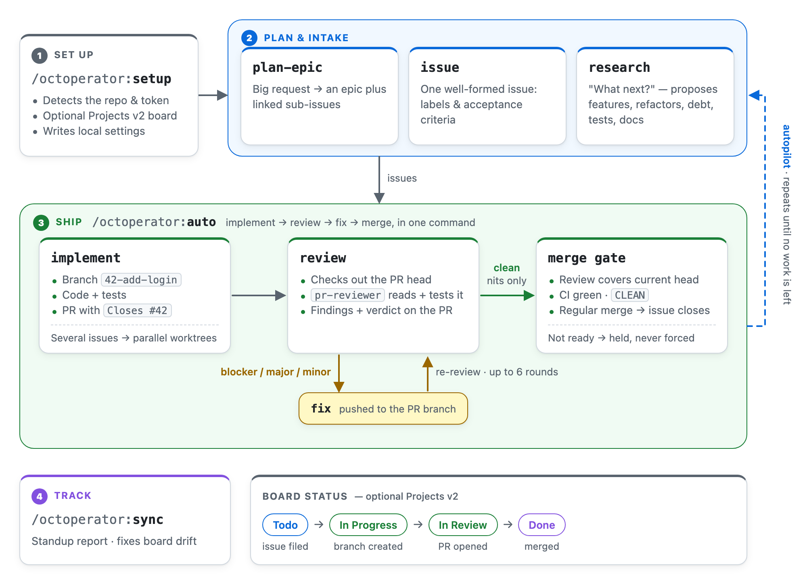

# Octoperator

**A Claude Code plugin that ships GitHub issues autonomously: implement, review, fix, and merge, with
every step a traceable issue, PR, and review.**

[](https://github.com/zeikar/octoperator/actions/workflows/ci.yml)
[](https://github.com/zeikar/octoperator/releases)
[](LICENSE)

Point Octoperator at an issue and `/octoperator:auto` takes it the rest of the way: a branch, code
and tests, a pull request, a structured review, fixes for what the review found, and a regular merge
once the review, CI, and GitHub all agree. `/octoperator:autopilot` repeats that loop over your
backlog and, when it runs dry, proposes what to build next. Everything happens in GitHub Issues and
pull requests, so agentic coding stays traceable from **request → issue → branch → PR → review →
merge**.

Built for solo developers and small teams who already work in GitHub and use Claude Code. A Projects
v2 board is optional: `/octoperator:setup` detects whether your token can use one.

## How it works

<picture>
  <source media="(prefers-color-scheme: dark)" srcset="docs/workflow-dark.png">
  
</picture>

**Operating posture: autonomous.** Skills execute immediately rather than asking for confirmation. To
preview what *would* happen without writing to GitHub, pass `--dry-run` (or say "dry run"). Every write
echoes the issue/PR numbers and URLs it created so the trail stays auditable.

## Quick start

Inside Claude Code:

```text
/plugin marketplace add zeikar/octoperator
/plugin install octoperator@zeikar-plugins
/octoperator:setup
```

Then, in a repo with an open issue:

```text
/octoperator:auto 42
  → branch 42-add-login, code + tests, PR "Closes #42", review, fixes, regular merge
```

You need the GitHub CLI signed in (`gh auth login`); see [Prerequisites](#prerequisites) and
[Installation](#installation) for the rest.

## Why Octoperator

- **GitHub is the record.** Every change is an issue, a branch, a reviewed PR, and a merge commit,
  not just a chat transcript.
- **It merges only through a gate.** A non-blocking review of the current head, green CI, and a
  `CLEAN` merge state; a PR that touches a path you mark for approval waits for a human.
- **It runs where you are.** It drives the [`gh` CLI](https://cli.github.com) with your existing
  `gh auth`: no server, no stored tokens, no GitHub App to install.
- **It knows when to stop.** Autopilot is bounded by a cycle cap, logs every run on a ledger issue,
  and switches to propose-only once runs stop making progress.

## Components

### Commands

| Command | What it does |
|---------|--------------|
| [`/octoperator:setup`](docs/commands.md#setup) | One-time onboarding: detect the repo, auto-detect Projects v2, write local settings |
| [`/octoperator:plan-epic <request>`](docs/commands.md#plan-epic) | Break a big request into an epic and linked child issues |
| [`/octoperator:issue <request>`](docs/commands.md#issue) | File one well-formed issue with labels and acceptance criteria |
| [`/octoperator:implement <issue#...>`](docs/commands.md#implement) | Branch, code, test, and open a PR; several issues run in parallel worktrees |
| [`/octoperator:auto <issue#...>`](docs/commands.md#auto) | Implement → review → fix (up to 6 rounds) → merge through the gate |
| [`/octoperator:autopilot`](docs/commands.md#autopilot) | Loop `auto` over the backlog; when it's empty, `research` proposes more |
| [`/octoperator:review <pr#>`](docs/commands.md#review) | Post a structured review with a verdict to a PR |
| [`/octoperator:sync`](docs/commands.md#sync) | Standup-style status report; fixes board drift |
| [`/octoperator:research`](docs/commands.md#research) | Rank proposed work across features, refactors, debt, tests, docs, and DX |
| [`/octoperator:genesis "<sentence>"`](docs/commands.md#genesis) | Start a new project from one sentence: research, a proposal, the repo, an MVP epic |

The `github-conventions` skill loads automatically and holds the conventions, `gh` cookbook, and
settings schema the others share. Every flag and gate is in the
[command reference](docs/commands.md).

### Agents

- **`issue-planner`** — decomposes a request into an epic + well-scoped child issues (used by `plan-epic`). Read-only; proposes structure.
- **`issue-implementer`** — implements a single issue inside a pre-created worktree, commits, pushes, and opens a PR (dispatched by `implement` for each parallel issue); in fix mode, fixes review findings on an existing PR for `auto`. Never writes to the project board.
- **`pr-reviewer`** — produces a structured, actionable PR review with a verdict (used by `review` and `auto`). Read-only; the skill posts the result.

## Prerequisites

- **GitHub CLI** (`gh`) installed and authenticated: `gh auth login`.
- A GitHub repository you can write to. **This is all Octoperator needs** — issues, branches, PRs,
  reviews, and traceability work without a project board.
- *(Optional)* a Projects v2 board for status tracking. Note: **user-owned Projects v2 require a
  classic PAT** with the `repo` + `project` scopes — fine-grained PATs do not support user-owned
  projects (org-owned projects work via a fine-grained token's Projects permission). `/octoperator:setup`
  auto-detects this and enables board features only when available.

## Installation

Local development / trial:

```bash
claude --plugin-dir /path/to/octoperator
```

Or install from this repo's marketplace inside Claude Code:

```text
/plugin marketplace add zeikar/octoperator
/plugin install octoperator@zeikar-plugins
```

## Configuration

The easiest path is the **setup skill**, which detects your repo, auto-detects whether your token can
use Projects v2, optionally creates or links a board, and writes the config:

```text
/octoperator:setup
```

Projects v2 is **optional and auto-detected** — when no board is available or configured, Octoperator
simply skips board status updates and everything else works unchanged.

Prefer to configure by hand? Settings live in `.claude/octoperator.local.md` (kept local-only —
Octoperator adds it to `.git/info/exclude`, never your `.gitignore`):

```bash
bash scripts/octo-doctor.sh --repo <owner>/<repo> [--project <number>]   # verify access
mkdir -p .claude
cp octoperator.local.md.example .claude/octoperator.local.md             # then edit
```

> The `scripts/...` paths are relative for running by hand from a clone. Inside Claude Code the skills
> invoke them via `${CLAUDE_PLUGIN_ROOT}/scripts/...`, which resolves wherever the plugin is installed.

Only `repo` (or a discoverable current repo) is required; board operations additionally need
`project_owner` + `project_number`. No GraphQL field/option IDs are stored by hand — Octoperator
resolves them by name at call time. Full schema:
[`skills/github-conventions/references/settings.md`](skills/github-conventions/references/settings.md).

### Unattended runs

`implement`, `auto`, `review`, and `autopilot` pre-allow the tools they use themselves — `gh`, `git`,
and `bash …` (which covers the helper scripts, and any `bash -c` command), plus
Read/Grep/Glob/Edit/Write/Task. Only `genesis` also pre-allows WebSearch and WebFetch, for its
capped research. A skill's grant lasts for the whole turn, and `research`, `implement`, and `auto`
run inside autopilot's turn reading untrusted text, so `autopilot` pre-allows no web tool and
`research` never uses one. Under autopilot, `genesis --next` plans ungrounded unless your own
settings allow both tools. Every step runs as one plain command with one of those prefixes:
Claude Code checks each part of a compound command, so the skills keep shell `if`s, `VAR=… cmd`
prefixes, `|| true`, and `sleep` out of their commands, and anything needing a loop or a pause lives
in a `scripts/octo-*.sh` helper. The grant lasts for the turn the skill runs in.

Two things the skills can't pre-allow for you:

- **Your repo's own commands** — the test command they run to verify each change, plus any lint,
  install, or build command the work runs.
- **Subagents.** Implementation (parallel path), `auto`'s fixes, and reviews run inside
  `issue-implementer` / `pr-reviewer` subagents, which call `gh`, `git`, and your tests, and edit
  files with Edit/Write. Claude Code doesn't document a skill's pre-allowed tools reaching a
  subagent; settings-file rules apply to the whole session, subagents included.

So for a run that never stops on a permission prompt (e.g. `autopilot --mode full`, or a
[scheduled run](docs/running-continuously.md)), allow these in the target repo's `.claude/settings.json`
(or `settings.local.json` to keep it personal):

```json
{
  "permissions": {
    "allow": ["Bash(npm test:*)", "Bash(gh:*)", "Bash(git:*)", "Edit", "Write"]
  }
}
```

Use your repo's actual commands — `Bash(pytest:*)`, `Bash(make test:*)`, `Bash(go test:*)`,
`Bash(npm ci:*)`, `Bash(npm run lint:*)`, …

## Usage example

```text
/octoperator:plan-epic Add passwordless email login with magic links
  → Epic #10 "Add passwordless email login" + child issues #11–#14, all on the board (Todo)

/octoperator:implement 11
  → branch 11-send-magic-link-email, code + tests, PR #20 "feat: send magic-link email"
    (Closes #11), #11 → In Review

/octoperator:auto 12 13
  → issues #12–#13 implemented in parallel worktrees, reviewed (blocker/major/minor findings
    fixed and re-reviewed; nits left), and regular-merged when the review is non-blocking and
    the PR is CLEAN

/octoperator:review 20
  → structured review posted to PR #20 with a verdict

/octoperator:sync
  → standup report; merged-PR issues auto-moved to Done
```

Every skill except `setup` accepts `--dry-run` to preview without writing to GitHub; `genesis`
takes it with `--approve` (its first run makes no GitHub write).

## Guides

- [Starting a new project (`genesis`)](docs/genesis.md): from one sentence to a private repo with
  an MVP epic, and the next milestone once every eval passes.
- [Running continuously](docs/running-continuously.md): re-run autopilot on a schedule with an
  in-session cron task, `/loop`, `/goal`, or `claude -p`.
- [Command reference](docs/commands.md): every command's flags and gates, in full.

## Product vision (`VISION.md`)

A `VISION.md` at the repo root acts as the project's constitution: its goal, target users, quality
bar, immutable constraints, and a roadmap that changes only on evidence. `research` reads it when
present — it drops proposals that break an immutable constraint or fall outside the goal (and lists
them with the reason), and ranks the rest by roadmap fit. `autopilot` never builds a change to the
immutable constraints, and `auto` never merges one: on every PR its merge gate holds, for a human,
any change to `VISION.md` outside its Roadmap body, or a Roadmap line that isn't plain text.
Deploy, spend, and delete work waits for a human: `research` labels it `needs-approval`,
`autopilot` skips it until a human adds `approved`, and `auto` holds any PR that touches an
`approval_paths` glob (see
[conventions → Approval gates](skills/github-conventions/references/conventions.md#approval-gates)).
Octoperator's own [`VISION.md`](VISION.md) doubles as an example to copy.

## Conventions

Octoperator follows a consistent, documented set of conventions (label taxonomy, branch naming, PR
linking, the epic/sub-issue model, the `Todo → In Progress → In Review → Done` status flow, and the
traceability matrix). They live in
[`skills/github-conventions/references/conventions.md`](skills/github-conventions/references/conventions.md).

## Troubleshooting

- **`gh: command not found`** — install the GitHub CLI: <https://cli.github.com>.
- **Project commands fail with a permission error (`Resource not accessible`, `createProjectV2`)** —
  user-owned Projects v2 are **not supported by fine-grained PATs**. Use a **classic PAT** with the
  `repo` + `project` scopes (or an org-owned project with a fine-grained token's Projects permission).
  If `gh` authenticates via the `GITHUB_TOKEN` env var, swap in the new token there and restart the
  session. Octoperator works fine without a board — board steps are skipped automatically.
- **`Status "X" not found`** — your board uses different option names; map them under `statuses:`
  (`todo`, `in_progress`, `in_review`, `blocked`, `done`) in `.claude/octoperator.local.md` — every
  board write goes through that mapping. Run `octo-doctor.sh` to list the real options.
- **Sub-issues not linking** — the account/plan may lack the sub-issue API; Octoperator falls back to a
  `- [ ] #n` task list in the epic body automatically.

## License

MIT © zeikar
